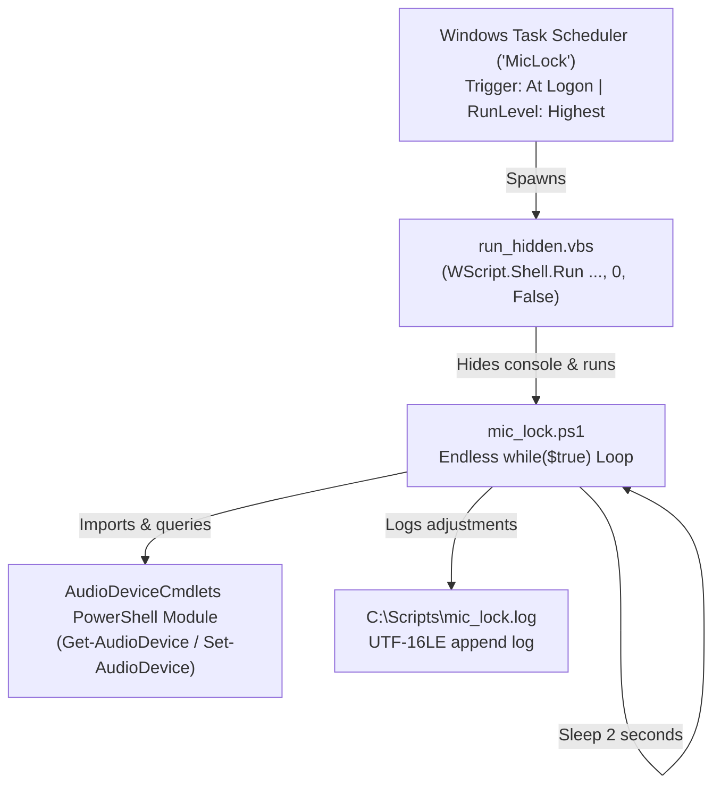

# 📜 Legacy PowerShell MicLock Architecture & Setup

This directory contains the archived **PowerShell + VBScript + Task Scheduler** setup adapted from [`Abeelha/windows-mic-lock`](https://github.com/Abeelha/windows-mic-lock/tree/869533af4e9ca6856710d63db95f522feb8019e1).

It is preserved here so the legacy approach can be **re-provisioned** or **uninstalled** completely from this self-contained folder at any time.

---

## 🏗️ How the Old Architecture Worked



### Components

1. **`mic_lock.ps1`**:
   - Imports `AudioDeviceCmdlets`.
   - Runs an infinite loop `while ($true) { ... Start-Sleep -Seconds 2 }`.
   - Calls `Get-AudioDevice -RecordingVolume`. Strips the `'%'` character and casts to `[float]`.
   - If volume `< 100%`, calls `Set-AudioDevice -RecordingVolume 100` and logs the event to `C:\Scripts\mic_lock.log`.
2. **`run_hidden.vbs`**:
   - Workaround for Windows 11: In modern Windows 11, running `powershell.exe -WindowStyle Hidden` still flashes an empty tab in the new Windows Terminal.
   - VBScript's `WshShell.Run(..., 0, False)` suppresses the window allocation entirely.
3. **`setup_task.xml` / Windows Task Scheduler**:
   - Configures a root task `\MicLock` triggered `AtLogon` with `RunLevel HighestAvailable` and `ExecutionTimeLimit PT0S` (never time out).

---

## ⚠️ Why This Setup Was Fragile (Root Cause Analysis)

1. **Latency Window (2–10 Seconds):**
   - Because it polled via `Start-Sleep -Seconds 2`, when Discord or Zoom lowered your mic during a voice call, there was an audible 2+ second drop where listeners could not hear you before the script snapped it back.
2. **PowerShell Type-Casting Bug in Abeelha's Reference:**
   - The upstream Abeelha reference script attempted `$mic.Volume`, which returned `$null`. `Get-AudioDevice -RecordingVolume` returns a string like `'75%'`, causing string comparisons (`'75%' -lt 100`) to fail in standard PowerShell.
3. **Administrative Elevation Lock-in:**
   - Creating the task with `RunLevel Highest` meant that standard users could not view, stop, or delete the task via normal Task Scheduler commands (`Access is denied`), making troubleshooting difficult without elevation.
4. **USB Disconnect / Crash:**
   - If a USB microphone (e.g. Samson Go Mic) was unplugged, `Get-AudioDevice` threw exceptions into the log loop until reconnected.

---

## 🚀 How to Re-Provision (Install)

To re-install and start the legacy setup on any machine:

1. Right-click **`install.bat`** and select **Run as Administrator** (or double-click; it will self-elevate).
   *Or from an elevated PowerShell:*
   ```powershell
   .\install.ps1
   ```
2. The installer will:
   - Copy `mic_lock.ps1` and `run_hidden.vbs` to `C:\Scripts\`.
   - Install the `AudioDeviceCmdlets` PowerShell module if missing.
   - Register the scheduled task `MicLock` in Windows Task Scheduler.
   - Start the task immediately.

---

## 🗑️ How to Completely Uninstall

### Option 1: Automated Script (Recommended)
Right-click **`uninstall.bat`** and select **Run as Administrator** (or double-click; it prompts for UAC elevation).
*Or from an elevated PowerShell:*
```powershell
.\uninstall.ps1
```

### Option 2: Manual Terminal Commands (Elevated Prompt)
Open **PowerShell as Administrator** and run:
```powershell
# 1. Stop and delete the Scheduled Task
schtasks /end /tn "MicLock"
schtasks /delete /tn "MicLock" /f

# 2. Kill any running polling processes
Get-CimInstance Win32_Process | Where-Object { $_.CommandLine -like "*mic_lock*" } | Stop-Process -Force -ErrorAction SilentlyContinue

# 3. Clean up the script files in C:\Scripts
Remove-Item "C:\Scripts\mic_lock.ps1", "C:\Scripts\run_hidden.vbs" -Force -ErrorAction SilentlyContinue
```

---

## ⏸️ Temporary Neutralization (Tmp Uninstall without Admin)

If you cannot open an elevated prompt right now but need to stop the script from fighting with the new standalone `MicLock.exe`:

Replace `C:\Scripts\mic_lock.ps1` with an empty exit stub:
```powershell
Set-Content "C:\Scripts\mic_lock.ps1" "# Disabled: Migrated to MicLock.exe`nExit 0"
Get-CimInstance Win32_Process | Where-Object { $_.CommandLine -like "*mic_lock*" } | Stop-Process -Force
```
This leaves the task intact in Task Scheduler, but whenever it triggers, it exits in 0 milliseconds and never modifies the audio volume.
